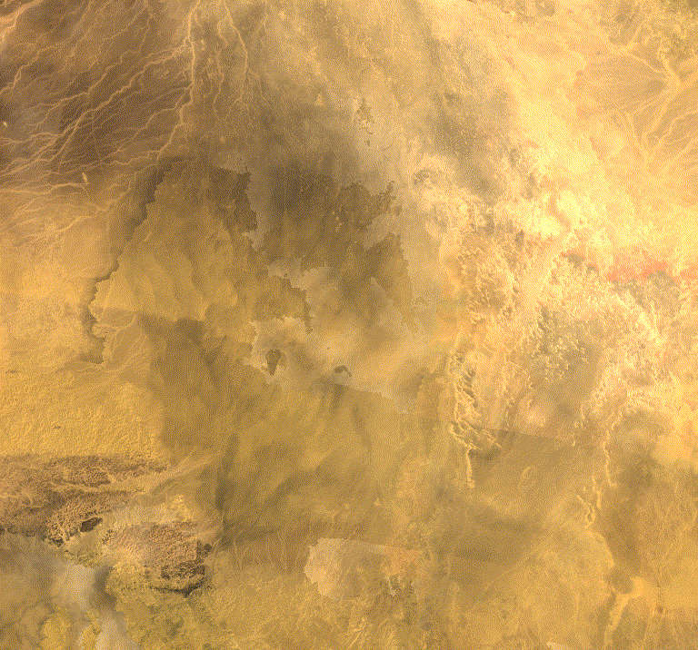
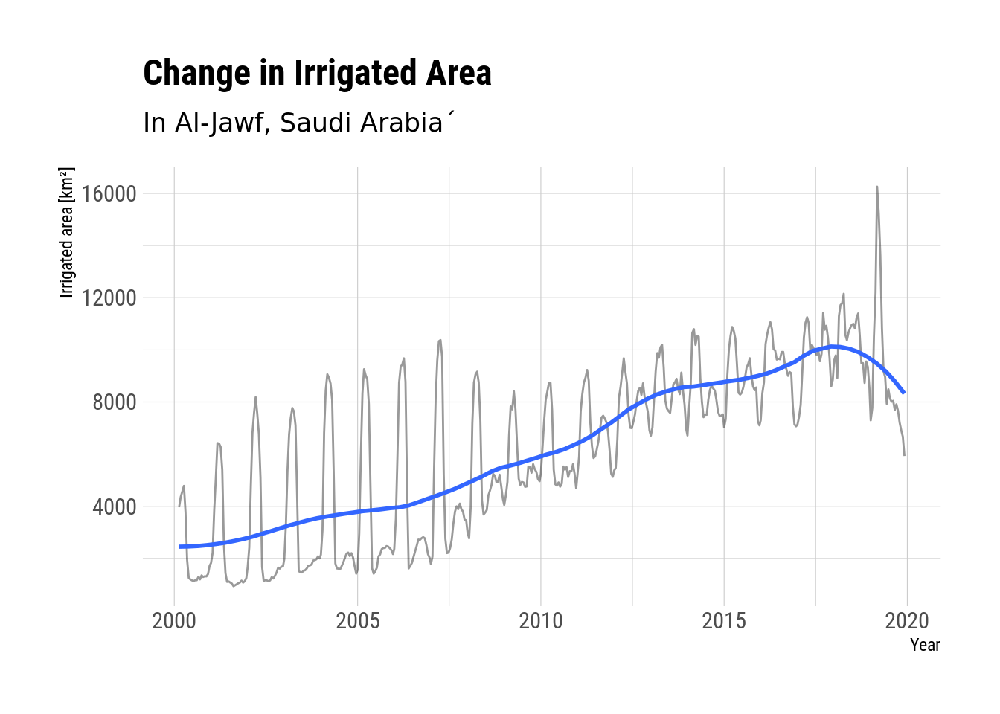
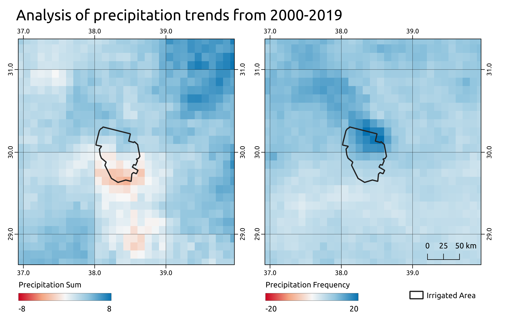

**Using Google Earth Engine and 20 years of MODIS and GPM (Global Precipitation Monitoring)
data, we were able to show that large-scale irrigation increases the precipitation frequency
in close proximity to the irrigated areas.**

*More details below.*

*This is a quick and very reduced summary of the work done for this analysis.*

With irrigation, most arid landscapes are very suitable for year-round agriculture. Over the
last decades Saudi Arabia has used groundwater stored in aquifers to increase its agricultural
output. One of the regions which benefited from the development of wells the most was Al-Jawf,
where an area of 10,000 km² is irrigated almost year round using groundwater.

We analysed if this large-scale irrigation impacts local precipitation patterns through
increased evapotranspiration.

Using MODIS data from 2000–2019 to classify irrigated areas and Global Precipitation
Measurement (GPM) data to analyse local precipitation patterns, correlations between the
irrigated area and precipitation frequency and amount could be identified.

The analysis was carried out using Google Earth Engine and showed an increased precipitation
frequency to the north of the irrigated area, while the sum of precipitation decreased south
of the irrigated area.

